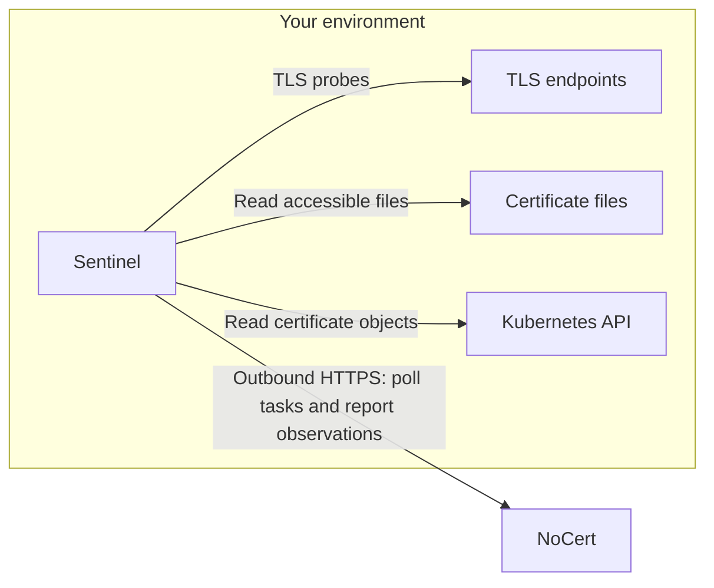

# NoCert Sentinel

NoCert Sentinel discovers deployed TLS certificates on your networks, Linux
hosts and Kubernetes clusters, and reports observations to [NoCert](https://nocert.io).
It observes certificates; it does not issue or renew them.

The agent currently requires a NoCert account. There is no standalone scan
command. Source code is licensed under Apache-2.0; the vendored shared library
uses MIT. See [LICENSE](LICENSE) and [THIRD_PARTY_NOTICES](THIRD_PARTY_NOTICES).

## What leaves your environment

| Source | Data sent to NoCert |
| --- | --- |
| Enrollment | Public signing key, hostname, OS, architecture, agent version, local IP address and interface subnets. |
| Network and local listeners | Certificate DER bytes and SHA-256 fingerprints, endpoint IP/port/SNI, observed TLS versions, cipher suites, negotiated group, OCSP stapling and HSTS observations when available. |
| Filesystem | Certificate DER bytes, fingerprints, certificate file paths and a warning when a nearby private-key file has overly broad permissions. The private-key path is not reported. |
| Kubernetes | Certificate DER bytes, fingerprints, configured cluster name, namespace, object name/kind, certificate data-key name and cert-manager attribution when present. |
| Task completion | Task identity/status and completeness information used to reconcile certificates and locations that disappeared. |

These observations can reveal internal hostnames, addresses and application
names. Review your scan scope and access permissions before enabling collection.

The agent does not upload private keys, enrollment credentials after enrollment,
Kubernetes credentials, complete configuration files or arbitrary Secret data.
The Kubernetes API returns complete Secret objects to the agent, including
private-key fields in memory; only allowlisted certificate fields are extracted
for reporting. Kubernetes RBAC cannot restrict Secret reads to `tls.crt`.

## Architecture and security



No inbound listener or firewall opening is required. The agent makes outbound
connections to the backend and to the configured scan targets. The backend
queues work; local switches can forbid each scan type.

Enrollment uses an organization enrollment token over HTTPS. The agent generates
its Ed25519 key locally and sends only the public key. Subsequent backend
requests carry RFC 9421 HTTP Message Signatures; responses are verified against
the server key pinned at enrollment. The local signing key is stored with mode
`0600`. By default the agent checks rotation every six hours and rotates when
less than five days remain, signing the rotation request with its current key.

The Debian service runs as an unprivileged user with systemd restrictions and
no Linux capabilities. It can only discover files accessible to that user.
The agent is not a security boundary against an administrator who can modify it.
Only scan systems you are authorized to inspect.

## Install

Supported packages: Debian/Ubuntu on **Linux amd64 and arm64**, using systemd.
Windows and macOS are not currently supported. Other Linux distributions need
their own service integration; no RPM is currently distributed.

```sh
sudo apt update
sudo apt install ca-certificates curl gnupg
sudo install -m 0755 -d /etc/apt/keyrings
sudo curl -fsSL https://repo.nocert.io/apt/gpg.key -o /etc/apt/keyrings/nocert.asc
sudo chmod a+r /etc/apt/keyrings/nocert.asc
gpg --show-keys --fingerprint /etc/apt/keyrings/nocert.asc
```

Check the fingerprint against the [source distribution page](https://nocert.io/sentinel-source):

```text
D5EF CB2E 291B 386D 5161 8CB3 E1DF FDD9 DF7B BB21
```

Then configure the repository:

```sh
sudo tee /etc/apt/sources.list.d/nocert.sources >/dev/null <<'EOF'
Types: deb
URIs: https://repo.nocert.io/apt
Suites: stable
Components: main
Architectures: amd64 arm64
Signed-By: /etc/apt/keyrings/nocert.asc
EOF
sudo apt update
sudo apt install nocert-sentinel
```

In NoCert, open **Sentinels > Deploy Sentinel** and follow the enrollment
instructions. Prefer a root-managed `/etc/nocert-sentinel/enroll.env` file with
mode `0600` containing `NOCERT_ENROLL_TOKEN=...`, then start the service:

```sh
sudo systemctl start nocert-sentinel
sudo systemctl status nocert-sentinel
sudo journalctl -u nocert-sentinel -f
```

The `--enroll-token` flag is also available, but exposes the token in process
arguments while it runs and forces a new identity. See
[enrollment and fleet deployment](https://docs.nocert.io/sentinels/enrollment).

## Configuration and proxies

The configuration is `/etc/nocert-sentinel/config.yaml`. See the
[example](configs/config.example.yaml) and
[configuration reference](https://docs.nocert.io/sentinels/configuration).
Unknown YAML keys fail startup, so a misspelled scan restriction is not ignored.

```yaml
server_url: "https://sentinel.nocert.io"
allow_network_scan: true
allow_filesystem_scan: true
allow_local_scan: true
allow_kubernetes_scan: false
log_level: info
```

The backend connection uses `HTTPS_PROXY`, `HTTP_PROXY` and `NO_PROXY` through
Go's standard proxy support. Configure the environment of the service, not just
your interactive shell. For example, `sudo systemctl edit nocert-sentinel`:

```ini
[Service]
Environment="HTTPS_PROXY=http://proxy.example.com:3128"
Environment="NO_PROXY=localhost,127.0.0.1"
```

Restart the service after changing configuration. TLS certificate verification
stays enabled; an intercepting proxy needs a trusted corporate CA on the host.
Network probes connect directly to scan targets; the backend proxy setting does
not turn them into HTTP proxy requests. Configure APT's proxy separately.

## Kubernetes and containers

The Sentinel can read clusters from an ordinary Linux host; it does not need to
run inside a cluster. See [Kubernetes setup](https://docs.nocert.io/sentinels/kubernetes)
and [example RBAC](configs/kubernetes-rbac.yaml). Prefer namespace-scoped grants
and matching namespace filters. Kubeconfig exec plugins are rejected.

The included [Dockerfile](Dockerfile) is a source-build option for network and
Kubernetes collection. It does not expose host files or host listeners. Disable
filesystem and local scans in its configuration. No prebuilt container image or
Helm chart is currently published. See [container instructions](docs/container.md).

## Build, test and reproduce

Use Go **1.27.2**. The repository includes the dependency sources under `vendor/`,
including only the shared-library packages this agent needs. There is no need
for access to another repository. Always use `-mod=vendor`; no sibling checkout
or module replacement is required.

```sh
GOTOOLCHAIN=go1.27.2 go test -mod=vendor -race ./...
GOTOOLCHAIN=go1.27.2 go vet -mod=vendor ./...
GOTOOLCHAIN=go1.27.2 CGO_ENABLED=0 GOOS=linux GOARCH=amd64 \
  go build -mod=vendor -trimpath -buildvcs=false \
  -ldflags '-s -w -X nocert.io/sentinel/internal/version.Version=VERSION' \
  -o nocert-sentinel ./cmd/nocert-sentinel
```

Replace `VERSION` with the release version and select the matching architecture.
Reproducibility refers to the agent binary, not the complete Debian package or
container image. For an existing release, use its signed source archive from
[the source distribution page](https://nocert.io/sentinel-source), the same exact
Go compiler and the same flags. Extract the corresponding `.deb` with
`dpkg-deb -x package.deb pkg` and compare the two binaries with `sha256sum`.

Release builds generate SPDX SBOMs and a `checksums.txt` covering the source,
packages, binary archives and SBOMs. Operator-signed releases use the fingerprint
above. Verify `checksums.txt.asc` with GPG before running `sha256sum -c checksums.txt`.
Artifacts from the manual GitHub prerelease build are unsigned review candidates,
not trusted releases. See [release verification](docs/releases.md).

## Contribute or report a problem

Issues and pull requests are welcome. Read [CONTRIBUTING.md](CONTRIBUTING.md)
for the integration workflow and [SECURITY.md](SECURITY.md) for confidential
vulnerability reports. Do not put credentials or customer inventories in an issue.

Documentation: [docs.nocert.io](https://docs.nocert.io/sentinels/overview).
Service: [nocert.io](https://nocert.io).
