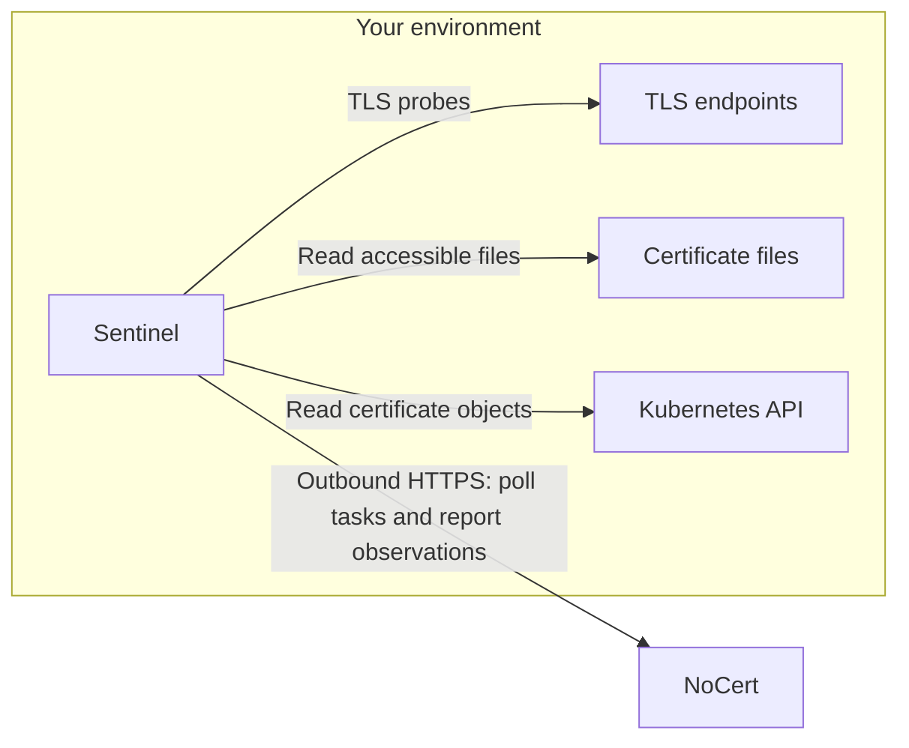

# Data collection and security

| Source | Data sent to NoCert |
| --- | --- |
| Enrollment | Public signing key, hostname, OS, architecture, agent version, local IP address and interface subnets. |
| Network and local listeners | Certificate DER bytes and SHA-256 fingerprints, endpoint IP/port/SNI, observed TLS versions, cipher suites, negotiated group, OCSP stapling and HSTS observations when available. |
| Filesystem | Certificate DER bytes, fingerprints, certificate file paths and a warning when a nearby private-key file has overly broad permissions. The private-key path is not reported. |
| Kubernetes | Certificate DER bytes, fingerprints, configured cluster name, namespace, object name/kind, certificate data-key name and cert-manager attribution when present. |
| Task completion | Task identity/status and completeness information used to reconcile certificates and locations that disappeared. |

These observations can reveal internal hostnames, addresses and application
names. Review your scan scope and access permissions before enabling collection.

The agent does not upload private keys, enrollment credentials after enrollment,
Kubernetes credentials, complete configuration files or arbitrary Secret data.
The Kubernetes API returns complete Secret objects to the agent, including
private-key fields in memory; only allowlisted certificate fields are extracted
for reporting. Kubernetes RBAC cannot restrict Secret reads to `tls.crt`.

## Connections and authentication

No inbound listener or firewall opening is required. The agent makes outbound
connections to the backend and to the configured scan targets. The backend
queues work; local switches can forbid each scan type.

Enrollment uses an organization enrollment token over HTTPS. The agent generates
its Ed25519 key locally and sends only the public key. Subsequent backend
requests carry RFC 9421 HTTP Message Signatures; responses are verified against
the server key pinned at enrollment. The local signing key is stored with mode
`0600`. By default the agent checks rotation every six hours and rotates when
less than five days remain, signing the rotation request with its current key.

The Debian service runs as an unprivileged user with systemd restrictions and
no Linux capabilities. It can only discover files accessible to that user.
The agent is not a security boundary against an administrator who can modify it.
Only scan systems you are authorized to inspect.
